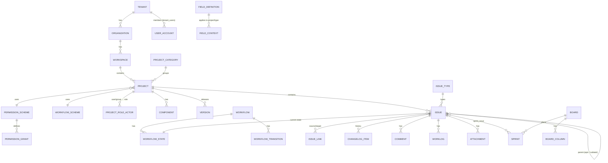
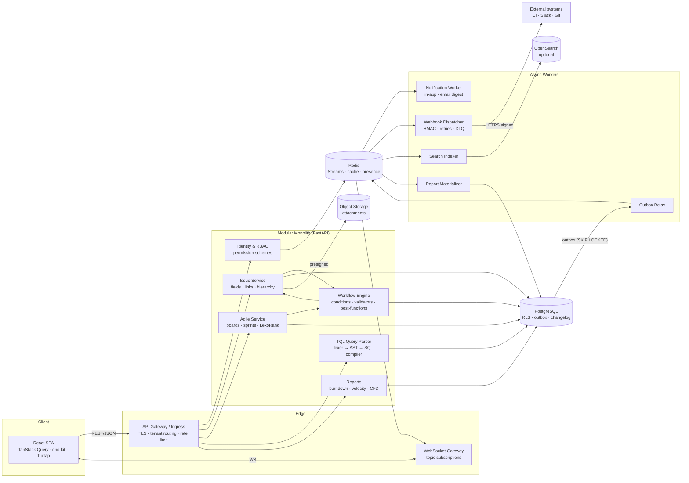

# TrackFlow — System Blueprint & Technical Specification

Issue tracking & Agile project management platform (Jira-class), multi-tenant target architecture.

> **Scope note.** This document describes the *target* multi-tenant architecture. The
> self-hosted build in this repository (`backend/`, `frontend/`) is the single-tenant
> edition of the same design: it omits `tenant_id`/RLS and uses a simpler ranking
> scheme and an in-process event bus. §7 maps each blueprint element to its
> implementation status and the migration path.

---

## 0. Design Principles

| Principle | Consequence |
|---|---|
| **Postgres is the source of truth** | All state, including events (transactional outbox), lives in PG. Caches and buses are derivable. |
| **Writes are short, row-scoped transactions** | Every mutation touches O(1) rows: fractional ranks, per-project counters, optimistic version checks. |
| **Tenant isolation at the database layer** | `tenant_id` on every row + Row-Level Security. App bugs must not leak data across tenants. |
| **Workflows are data, not code** | States, transitions, guards and post-functions are rows evaluated by a generic engine. |
| **History is append-only** | A changelog row for every field change drives activity feeds, audit, burndown, and CFD. |
| **Side-effects after commit** | Notifications, webhooks and WebSocket pushes are dispatched from the outbox only after COMMIT. |

---

## 1. Domain Model & Database Schema

### 1.1 Entity-relationship overview



### 1.2 Multi-tenancy strategy

Three common options:

| Strategy | Isolation | Ops cost | Cross-tenant analytics | Verdict |
|---|---|---|---|---|
| DB-per-tenant | Strongest | High: N migrations, N pools | Hard | Use only for regulated or enterprise tenants |
| Schema-per-tenant | Strong | Medium: catalog bloat above ~5k schemas | Hard | No |
| **Shared tables + `tenant_id` + RLS** | Strong if RLS is enforced | Low | Easy | **Default** |

Use shared tables. Large tenants can move to a dedicated database later with the same schema, routed by `tenants.shard_id`. Every tenant-scoped table:

* has `tenant_id uuid NOT NULL`;
* leads every composite index and unique key with `tenant_id`, so lookups stay tenant-local and partitions prune;
* has RLS enabled.

```sql
-- Session variable set by the API per request/transaction:  SET LOCAL app.tenant_id = '<uuid>';
CREATE OR REPLACE FUNCTION current_tenant() RETURNS uuid
LANGUAGE sql STABLE AS $$ SELECT current_setting('app.tenant_id')::uuid $$;

-- Applied to every tenant-scoped table (generated by migration helper):
ALTER TABLE issue ENABLE ROW LEVEL SECURITY;
ALTER TABLE issue FORCE ROW LEVEL SECURITY;           -- applies to table owner too
CREATE POLICY tenant_isolation ON issue
  USING (tenant_id = current_tenant())
  WITH CHECK (tenant_id = current_tenant());
-- The application role is NOT superuser and NOT BYPASSRLS. Maintenance jobs use a separate role.
```

### 1.3 Governance: tenants, orgs, users, roles, permission schemes

```sql
CREATE EXTENSION IF NOT EXISTS pgcrypto;   -- gen_random_uuid()
CREATE EXTENSION IF NOT EXISTS pg_trgm;    -- fuzzy text search
CREATE EXTENSION IF NOT EXISTS citext;

CREATE TABLE tenant (
  id            uuid PRIMARY KEY DEFAULT gen_random_uuid(),
  slug          citext UNIQUE NOT NULL,          -- acme.trackflow.app
  name          text NOT NULL,
  plan          text NOT NULL DEFAULT 'standard',
  shard_id      smallint NOT NULL DEFAULT 0,
  status        text NOT NULL DEFAULT 'active' CHECK (status IN ('active','suspended','deleted')),
  created_at    timestamptz NOT NULL DEFAULT now()
);

CREATE TABLE organization (
  id         uuid PRIMARY KEY DEFAULT gen_random_uuid(),
  tenant_id  uuid NOT NULL REFERENCES tenant(id) ON DELETE CASCADE,
  name       text NOT NULL,
  UNIQUE (tenant_id, name)
);

CREATE TABLE workspace (
  id              uuid PRIMARY KEY DEFAULT gen_random_uuid(),
  tenant_id       uuid NOT NULL REFERENCES tenant(id) ON DELETE CASCADE,
  organization_id uuid NOT NULL REFERENCES organization(id) ON DELETE CASCADE,
  name            text NOT NULL,
  UNIQUE (tenant_id, organization_id, name)
);

-- Global identity (a person may belong to several tenants)
CREATE TABLE user_account (
  id             uuid PRIMARY KEY DEFAULT gen_random_uuid(),
  email          citext UNIQUE NOT NULL,
  display_name   text NOT NULL,
  password_hash  text,                           -- null when SSO-only
  token_version  int NOT NULL DEFAULT 0,         -- bump to revoke all sessions
  created_at     timestamptz NOT NULL DEFAULT now()
);

CREATE TABLE tenant_user (
  tenant_id   uuid NOT NULL REFERENCES tenant(id) ON DELETE CASCADE,
  user_id     uuid NOT NULL REFERENCES user_account(id) ON DELETE CASCADE,
  global_role text NOT NULL DEFAULT 'member' CHECK (global_role IN ('site_admin','member','guest')),
  is_active   boolean NOT NULL DEFAULT true,
  PRIMARY KEY (tenant_id, user_id)
);

CREATE TABLE user_group (
  id        uuid PRIMARY KEY DEFAULT gen_random_uuid(),
  tenant_id uuid NOT NULL REFERENCES tenant(id) ON DELETE CASCADE,
  name      text NOT NULL,
  UNIQUE (tenant_id, name)
);
CREATE TABLE group_member (
  tenant_id uuid NOT NULL,
  group_id  uuid NOT NULL REFERENCES user_group(id) ON DELETE CASCADE,
  user_id   uuid NOT NULL REFERENCES user_account(id) ON DELETE CASCADE,
  PRIMARY KEY (tenant_id, group_id, user_id)
);

-- Project roles are tenant-defined ("Developer", "Scrum Master", ...)
CREATE TABLE project_role (
  id        uuid PRIMARY KEY DEFAULT gen_random_uuid(),
  tenant_id uuid NOT NULL REFERENCES tenant(id) ON DELETE CASCADE,
  name      text NOT NULL,
  UNIQUE (tenant_id, name)
);

-- Permission scheme: reusable bundle of grants, assigned to many projects
CREATE TABLE permission_scheme (
  id        uuid PRIMARY KEY DEFAULT gen_random_uuid(),
  tenant_id uuid NOT NULL REFERENCES tenant(id) ON DELETE CASCADE,
  name      text NOT NULL,
  UNIQUE (tenant_id, name)
);

-- permission: BROWSE_PROJECT, CREATE_ISSUE, EDIT_ISSUE, TRANSITION_ISSUE, ASSIGN_ISSUE,
--             MANAGE_SPRINTS, SCHEDULE_ISSUE (rank), DELETE_ISSUE, ADD_COMMENT, ADMINISTER_PROJECT ...
-- holder_type: role | group | user | reporter | assignee | anyone_logged_in
CREATE TABLE permission_grant (
  id          uuid PRIMARY KEY DEFAULT gen_random_uuid(),
  tenant_id   uuid NOT NULL,
  scheme_id   uuid NOT NULL REFERENCES permission_scheme(id) ON DELETE CASCADE,
  permission  text NOT NULL,
  holder_type text NOT NULL CHECK (holder_type IN ('role','group','user','reporter','assignee','anyone_logged_in')),
  holder_id   uuid,                                  -- role/group/user id; null for dynamic holders
  UNIQUE (scheme_id, permission, holder_type, holder_id)
);
CREATE INDEX ix_grant_lookup ON permission_grant (tenant_id, scheme_id, permission);
```

### 1.4 Project context

```sql
CREATE TABLE project_category (
  id uuid PRIMARY KEY DEFAULT gen_random_uuid(),
  tenant_id uuid NOT NULL, name text NOT NULL, UNIQUE (tenant_id, name)
);

CREATE TABLE project (
  id                    uuid PRIMARY KEY DEFAULT gen_random_uuid(),
  tenant_id             uuid NOT NULL REFERENCES tenant(id) ON DELETE CASCADE,
  workspace_id          uuid NOT NULL REFERENCES workspace(id),
  category_id           uuid REFERENCES project_category(id) ON DELETE SET NULL,
  key                   text NOT NULL CHECK (key ~ '^[A-Z][A-Z0-9]{1,9}$'),
  name                  text NOT NULL,
  lead_id               uuid REFERENCES user_account(id),
  permission_scheme_id  uuid NOT NULL REFERENCES permission_scheme(id),
  workflow_scheme_id    uuid NOT NULL,
  field_config_scheme_id uuid,
  issue_seq             bigint NOT NULL DEFAULT 0,      -- next issue number (row-locked on insert)
  archived_at           timestamptz,
  created_at            timestamptz NOT NULL DEFAULT now(),
  UNIQUE (tenant_id, key)
);

-- Who holds which role in which project (users or groups)
CREATE TABLE project_role_actor (
  tenant_id  uuid NOT NULL,
  project_id uuid NOT NULL REFERENCES project(id) ON DELETE CASCADE,
  role_id    uuid NOT NULL REFERENCES project_role(id) ON DELETE CASCADE,
  actor_type text NOT NULL CHECK (actor_type IN ('user','group')),
  actor_id   uuid NOT NULL,
  PRIMARY KEY (project_id, role_id, actor_type, actor_id)
);
CREATE INDEX ix_role_actor_actor ON project_role_actor (tenant_id, actor_type, actor_id);

-- Dynamic issue types (tenant-wide), hierarchy level drives parent rules
CREATE TABLE issue_type (
  id              uuid PRIMARY KEY DEFAULT gen_random_uuid(),
  tenant_id       uuid NOT NULL,
  name            text NOT NULL,                 -- Epic, Story, Task, Bug, Sub-task, Spike ...
  icon            text,
  hierarchy_level smallint NOT NULL DEFAULT 0,   -- 1 = epic, 0 = standard, -1 = subtask
  UNIQUE (tenant_id, name)
);
-- Which types a project offers (issue type scheme, flattened)
CREATE TABLE project_issue_type (
  project_id uuid REFERENCES project(id) ON DELETE CASCADE,
  issue_type_id uuid REFERENCES issue_type(id),
  position smallint NOT NULL DEFAULT 0,
  PRIMARY KEY (project_id, issue_type_id)
);

CREATE TABLE component (
  id uuid PRIMARY KEY DEFAULT gen_random_uuid(),
  tenant_id uuid NOT NULL, project_id uuid NOT NULL REFERENCES project(id) ON DELETE CASCADE,
  name text NOT NULL, lead_id uuid REFERENCES user_account(id),
  default_assignee text NOT NULL DEFAULT 'project_default',
  UNIQUE (project_id, name)
);

CREATE TABLE version (
  id uuid PRIMARY KEY DEFAULT gen_random_uuid(),
  tenant_id uuid NOT NULL, project_id uuid NOT NULL REFERENCES project(id) ON DELETE CASCADE,
  name text NOT NULL, description text,
  start_date date, release_date date,
  status text NOT NULL DEFAULT 'unreleased' CHECK (status IN ('unreleased','released','archived')),
  sequence int NOT NULL,
  UNIQUE (project_id, name)
);
```

### 1.5 Issue engine

**Description format.** Store rich text as a ProseMirror document (`jsonb`). Also store a derived `description_text`, a plain-text projection written in the same transaction, for full-text search and notification previews. Never search inside the AST directly.

```sql
CREATE TABLE issue (
  id                uuid PRIMARY KEY DEFAULT gen_random_uuid(),
  tenant_id         uuid NOT NULL,
  project_id        uuid NOT NULL REFERENCES project(id) ON DELETE CASCADE,
  number            bigint NOT NULL,                       -- 123 in PROJ-123
  issue_type_id     uuid NOT NULL REFERENCES issue_type(id),
  summary           text NOT NULL CHECK (length(summary) BETWEEN 1 AND 255),
  description       jsonb,                                 -- ProseMirror AST
  description_text  text,                                  -- derived plain text
  status_id         uuid NOT NULL REFERENCES workflow_state(id),
  resolution_id     uuid REFERENCES resolution(id),        -- null = unresolved
  priority_id       uuid REFERENCES priority(id),
  assignee_id       uuid REFERENCES user_account(id),
  reporter_id       uuid REFERENCES user_account(id),
  parent_id         uuid REFERENCES issue(id) ON DELETE SET NULL,
  rank              text NOT NULL COLLATE "C",             -- LexoRank, byte-order comparison
  story_points      numeric(6,2) CHECK (story_points >= 0),
  original_estimate_s int, remaining_estimate_s int, time_spent_s int NOT NULL DEFAULT 0,
  due_date          date,
  labels            text[] NOT NULL DEFAULT '{}',
  custom            jsonb NOT NULL DEFAULT '{}',           -- hot custom fields (see 1.6)
  version           int NOT NULL DEFAULT 1,                -- optimistic concurrency
  created_at        timestamptz NOT NULL DEFAULT now(),
  updated_at        timestamptz NOT NULL DEFAULT now(),
  resolved_at       timestamptz,
  search_tsv        tsvector GENERATED ALWAYS AS (
                      setweight(to_tsvector('simple', coalesce(summary,'')), 'A') ||
                      setweight(to_tsvector('english', coalesce(description_text,'')), 'B')) STORED,
  UNIQUE (project_id, number)
);
-- The key "PROJ-123" is computed (project.key || '-' || number), not stored, so renaming a project key
-- does not rewrite millions of rows. Keep an issue_key_alias(old_key, issue_id) table for old links.

CREATE INDEX ix_issue_board     ON issue (tenant_id, project_id, status_id, rank);
CREATE INDEX ix_issue_rank      ON issue (tenant_id, project_id, rank);
CREATE INDEX ix_issue_assignee  ON issue (tenant_id, assignee_id) WHERE resolution_id IS NULL;
CREATE INDEX ix_issue_parent    ON issue (parent_id) WHERE parent_id IS NOT NULL;
CREATE INDEX ix_issue_updated   ON issue (tenant_id, updated_at DESC);
CREATE INDEX ix_issue_due       ON issue (tenant_id, due_date) WHERE resolution_id IS NULL;
CREATE INDEX ix_issue_labels    ON issue USING gin (labels);
CREATE INDEX ix_issue_custom    ON issue USING gin (custom jsonb_path_ops);
CREATE INDEX ix_issue_fts       ON issue USING gin (search_tsv);
CREATE INDEX ix_issue_summary_trgm ON issue USING gin (summary gin_trgm_ops);

CREATE TABLE issue_component (issue_id uuid REFERENCES issue(id) ON DELETE CASCADE,
                              component_id uuid REFERENCES component(id) ON DELETE CASCADE,
                              PRIMARY KEY (issue_id, component_id));
CREATE TABLE issue_version   (issue_id uuid REFERENCES issue(id) ON DELETE CASCADE,
                              version_id uuid REFERENCES version(id) ON DELETE CASCADE,
                              relation text NOT NULL CHECK (relation IN ('fix','affects')),
                              PRIMARY KEY (issue_id, version_id, relation));
```

**Hierarchy rules.** These are enforced in the service layer and backed by a trigger:

* `hierarchy_level` of the parent = child level + 1. Epic(1) → Story/Task/Bug(0) → Sub-task(-1).
* The parent must be in the same tenant. Cross-project parents are allowed only for epics, if the tenant enables it.
* Cycles cannot occur because the level strictly increases going up.

**Issue links** are directional. A link type defines both phrasings:

```sql
CREATE TABLE issue_link_type (
  id uuid PRIMARY KEY DEFAULT gen_random_uuid(), tenant_id uuid NOT NULL,
  name text NOT NULL,              -- Blocks
  outward text NOT NULL,           -- "blocks"
  inward  text NOT NULL,           -- "is blocked by"
  is_dependency boolean NOT NULL DEFAULT false,   -- participates in dependency graph / cycle checks
  UNIQUE (tenant_id, name)
);
CREATE TABLE issue_link (
  id uuid PRIMARY KEY DEFAULT gen_random_uuid(), tenant_id uuid NOT NULL,
  link_type_id uuid NOT NULL REFERENCES issue_link_type(id),
  source_id uuid NOT NULL REFERENCES issue(id) ON DELETE CASCADE,   -- outward side
  target_id uuid NOT NULL REFERENCES issue(id) ON DELETE CASCADE,   -- inward side
  created_by uuid, created_at timestamptz NOT NULL DEFAULT now(),
  CHECK (source_id <> target_id),
  UNIQUE (link_type_id, source_id, target_id)
);
CREATE INDEX ix_link_target ON issue_link (target_id);   -- inward lookups
```

For dependency link types, reject cycles on insert. Use a recursive CTE bounded to depth 50:

```sql
WITH RECURSIVE reach(id, depth) AS (
  SELECT target_id, 1 FROM issue_link WHERE source_id = :new_target AND link_type_id = :t
  UNION
  SELECT l.target_id, r.depth + 1 FROM issue_link l JOIN reach r ON l.source_id = r.id
  WHERE l.link_type_id = :t AND r.depth < 50
)
SELECT EXISTS (SELECT 1 FROM reach WHERE id = :new_source) AS creates_cycle;
```

### 1.6 Dynamic custom fields: EAV vs JSONB

| Concern | EAV (`field_value` rows) | JSONB column on `issue` |
|---|---|---|
| Read one issue with all fields | N joins or a pivot | 1 row, no joins ✅ |
| Filter on a field (`cf[10] = 'x'`) | B-tree on `(field_id, value_*)` ✅ | GIN `jsonb_path_ops` containment ✅; expression index for ranges |
| Range queries (dates, numbers) | Typed columns `value_num`, `value_date` ✅ | Needs an expression index per field ⚠️ |
| Sort by custom field | Join + sort, slow | Expression sort, OK with an index |
| Multi-value (multi-select, users) | Natural (multiple rows) ✅ | Arrays; containment works |
| Per-field change history | Natural | Diff in app layer (we already do this) |
| Schema evolution | None | None |
| Write amplification | 1 row per field changed ✅ | Whole TOASTed jsonb rewritten ⚠️ for large docs |
| Referential integrity (option ids, user ids) | FK possible ✅ | None (validated in app) |

**Decision: a hybrid of JSONB storage and typed definitions.**

* Values live in `issue.custom` as `jsonb`, keyed by the stable field id (`{"cf_9f2c": 13, "cf_77aa": ["opt_1","opt_3"]}`). Reads are cheap and the board and list views load in one query.
* For fields an admin marks *searchable-range* (number/date), the migrator creates a partial expression index on demand:
  `CREATE INDEX CONCURRENTLY ix_cf_9f2c ON issue (((custom->>'cf_9f2c')::numeric)) WHERE custom ? 'cf_9f2c';`
* High-cardinality multi-user fields (for example "Reviewers") can opt into an EAV side table `issue_field_value(issue_id, field_id, user_id)`. That keeps reverse lookups ("issues where I'm a reviewer") on a B-tree.

```sql
CREATE TABLE field_definition (
  id          text PRIMARY KEY,                 -- 'cf_9f2c' (stable, never reused)
  tenant_id   uuid NOT NULL,
  name        text NOT NULL,
  field_type  text NOT NULL CHECK (field_type IN
               ('text','textarea','number','date','datetime','select','multiselect','user','multiuser','url','labels')),
  searcher    text NOT NULL DEFAULT 'exact',    -- exact | range | text | none
  UNIQUE (tenant_id, name)
);
CREATE TABLE field_option (
  id text PRIMARY KEY, field_id text NOT NULL REFERENCES field_definition(id) ON DELETE CASCADE,
  value text NOT NULL, position int NOT NULL, disabled boolean NOT NULL DEFAULT false
);
-- Field context = where a field applies + its config (required, default) — mirrors Jira's field config scheme
CREATE TABLE field_context (
  id uuid PRIMARY KEY DEFAULT gen_random_uuid(), tenant_id uuid NOT NULL,
  field_id text NOT NULL REFERENCES field_definition(id) ON DELETE CASCADE,
  project_id uuid REFERENCES project(id) ON DELETE CASCADE,       -- null = global
  issue_type_id uuid REFERENCES issue_type(id) ON DELETE CASCADE, -- null = all types
  required boolean NOT NULL DEFAULT false,
  default_value jsonb,
  screen_tab text, position int NOT NULL DEFAULT 0
);
CREATE INDEX ix_field_ctx ON field_context (tenant_id, project_id, issue_type_id);
```

To resolve the effective field configuration for (project, type), take the most specific context in this order: (project, type) → (project, null) → (null, type) → (null, null). Cache the result per (tenant, project, type) and invalidate it on any `field_context` write.

### 1.7 Agile engine

```sql
CREATE TABLE board (
  id uuid PRIMARY KEY DEFAULT gen_random_uuid(), tenant_id uuid NOT NULL,
  name text NOT NULL,
  board_type text NOT NULL CHECK (board_type IN ('scrum','kanban')),
  filter_jql text NOT NULL,                     -- board = saved query, e.g. 'project = PROJ'
  swimlane_mode text NOT NULL DEFAULT 'none' CHECK (swimlane_mode IN ('none','assignee','epic','priority','query')),
  kanban_done_age interval DEFAULT '14 days'    -- hide resolved cards older than this
);
CREATE TABLE board_column (
  id uuid PRIMARY KEY DEFAULT gen_random_uuid(), board_id uuid NOT NULL REFERENCES board(id) ON DELETE CASCADE,
  name text NOT NULL, position smallint NOT NULL,
  wip_min int, wip_max int
);
CREATE TABLE board_column_status (               -- many statuses can map to one column
  column_id uuid REFERENCES board_column(id) ON DELETE CASCADE,
  status_id uuid REFERENCES workflow_state(id) ON DELETE CASCADE,
  PRIMARY KEY (column_id, status_id)
);

CREATE TABLE sprint (
  id uuid PRIMARY KEY DEFAULT gen_random_uuid(), tenant_id uuid NOT NULL,
  board_id uuid NOT NULL REFERENCES board(id) ON DELETE CASCADE,
  name text NOT NULL, goal text,
  state text NOT NULL DEFAULT 'future' CHECK (state IN ('future','active','closed')),
  start_at timestamptz, end_at timestamptz, completed_at timestamptz,
  sequence int NOT NULL,
  CHECK (end_at IS NULL OR start_at IS NULL OR end_at >= start_at)
);
-- At most one active sprint per board (unless the tenant enables parallel sprints)
CREATE UNIQUE INDEX ux_one_active_sprint ON sprint (board_id) WHERE state = 'active';

-- An issue can have been in many sprints over time (carry-over); exactly one is "current".
CREATE TABLE sprint_issue (
  sprint_id uuid REFERENCES sprint(id) ON DELETE CASCADE,
  issue_id  uuid REFERENCES issue(id) ON DELETE CASCADE,
  tenant_id uuid NOT NULL,
  added_at  timestamptz NOT NULL DEFAULT now(),
  removed_at timestamptz,                         -- null = currently in sprint
  added_after_start boolean NOT NULL DEFAULT false,  -- scope creep marker
  PRIMARY KEY (sprint_id, issue_id, added_at)
);
CREATE UNIQUE INDEX ux_issue_current_sprint ON sprint_issue (issue_id) WHERE removed_at IS NULL;

-- Immutable snapshot written at sprint start & completion (sprint report, velocity)
CREATE TABLE sprint_snapshot (
  sprint_id uuid REFERENCES sprint(id) ON DELETE CASCADE,
  kind text CHECK (kind IN ('start','complete')),
  taken_at timestamptz NOT NULL DEFAULT now(),
  issues jsonb NOT NULL,          -- [{issue_id, points, status_category}]
  total_points numeric NOT NULL,
  PRIMARY KEY (sprint_id, kind)
);
```

Backlog order is defined by `issue.rank`, and every board on a project shares one global rank. That matches Jira's behaviour: ranking on one board affects the others. See §3.

### 1.8 Audit & activity

```sql
-- Changelog: one group per user action, many items per group (one per field)
CREATE TABLE changelog_group (
  id bigserial PRIMARY KEY, tenant_id uuid NOT NULL,
  issue_id uuid NOT NULL REFERENCES issue(id) ON DELETE CASCADE,
  actor_id uuid, created_at timestamptz NOT NULL DEFAULT now(),
  source text NOT NULL DEFAULT 'web'      -- web | api | automation | import
);
CREATE TABLE changelog_item (
  id bigserial PRIMARY KEY,
  group_id bigint NOT NULL REFERENCES changelog_group(id) ON DELETE CASCADE,
  field text NOT NULL,                    -- 'status', 'assignee', 'cf_9f2c', 'sprint', 'rank'
  from_ref text, from_display text,       -- machine id + human label at time of change
  to_ref text,   to_display text
);
CREATE INDEX ix_changelog_issue ON changelog_group (issue_id, created_at);
CREATE INDEX ix_changelog_field ON changelog_item (field, group_id);   -- report scans (status, sprint, points)
-- Partition changelog_group by RANGE (created_at) monthly once volume > ~50M rows.

CREATE TABLE comment (
  id uuid PRIMARY KEY DEFAULT gen_random_uuid(), tenant_id uuid NOT NULL,
  issue_id uuid NOT NULL REFERENCES issue(id) ON DELETE CASCADE,
  author_id uuid, body jsonb NOT NULL, body_text text NOT NULL,
  visibility_role_id uuid,                 -- restricted comments
  created_at timestamptz NOT NULL DEFAULT now(), updated_at timestamptz NOT NULL DEFAULT now(),
  deleted_at timestamptz
);
CREATE INDEX ix_comment_issue ON comment (issue_id, created_at);

CREATE TABLE worklog (
  id uuid PRIMARY KEY DEFAULT gen_random_uuid(), tenant_id uuid NOT NULL,
  issue_id uuid NOT NULL REFERENCES issue(id) ON DELETE CASCADE,
  author_id uuid NOT NULL, started_at timestamptz NOT NULL,
  time_spent_s int NOT NULL CHECK (time_spent_s > 0), comment text,
  created_at timestamptz NOT NULL DEFAULT now()
);
CREATE INDEX ix_worklog_author_day ON worklog (tenant_id, author_id, started_at);  -- timesheets

CREATE TABLE attachment (
  id uuid PRIMARY KEY DEFAULT gen_random_uuid(), tenant_id uuid NOT NULL,
  issue_id uuid NOT NULL REFERENCES issue(id) ON DELETE CASCADE,
  uploader_id uuid, filename text NOT NULL, mime_type text NOT NULL,
  size_bytes bigint NOT NULL, sha256 bytea NOT NULL,
  storage_key text NOT NULL,      -- s3://bucket/tenant/<uuid>; never derived from filename
  scan_status text NOT NULL DEFAULT 'pending' CHECK (scan_status IN ('pending','clean','infected')),
  created_at timestamptz NOT NULL DEFAULT now()
);

-- Administrative audit (who changed permission schemes, workflows, users ...)
CREATE TABLE audit_event (
  id bigserial PRIMARY KEY, tenant_id uuid NOT NULL, actor_id uuid,
  action text NOT NULL, entity_type text NOT NULL, entity_id text,
  before jsonb, after jsonb, ip inet, user_agent text,
  created_at timestamptz NOT NULL DEFAULT now()
) PARTITION BY RANGE (created_at);
```

---

## 2. Workflow & State Machine Engine

### 2.1 Workflow definition schema

A workflow is a directed graph. States are nodes, transitions are edges, and every transition carries ordered lists of **conditions**, **validators** and **post-functions**. Each rule is a `(type, config jsonb)` pair resolved against a registry in code.

```sql
CREATE TABLE workflow (
  id uuid PRIMARY KEY DEFAULT gen_random_uuid(), tenant_id uuid NOT NULL,
  name text NOT NULL, version int NOT NULL DEFAULT 1,
  is_draft boolean NOT NULL DEFAULT false,
  UNIQUE (tenant_id, name, version)
);
CREATE TABLE workflow_state (
  id uuid PRIMARY KEY DEFAULT gen_random_uuid(), tenant_id uuid NOT NULL,
  workflow_id uuid NOT NULL REFERENCES workflow(id) ON DELETE CASCADE,
  name text NOT NULL,                                   -- Backlog, In Progress, Code Review, Done
  category text NOT NULL CHECK (category IN ('todo','in_progress','done')),  -- drives reports & colours
  is_initial boolean NOT NULL DEFAULT false,
  UNIQUE (workflow_id, name)
);
CREATE UNIQUE INDEX ux_one_initial ON workflow_state (workflow_id) WHERE is_initial;

CREATE TABLE workflow_transition (
  id uuid PRIMARY KEY DEFAULT gen_random_uuid(), tenant_id uuid NOT NULL,
  workflow_id uuid NOT NULL REFERENCES workflow(id) ON DELETE CASCADE,
  name text NOT NULL,                                   -- "Start progress", "Submit for review"
  from_state_id uuid REFERENCES workflow_state(id),     -- NULL = global transition (from any state)
  to_state_id uuid NOT NULL REFERENCES workflow_state(id),
  screen_id uuid,                                       -- optional transition screen (fields to collect)
  conditions jsonb NOT NULL DEFAULT '[]',               -- [{"type":"user_in_role","config":{"role":"Developer"}}]
  validators jsonb NOT NULL DEFAULT '[]',               -- [{"type":"field_required","config":{"field":"resolution"}}]
  post_functions jsonb NOT NULL DEFAULT '[]',           -- [{"type":"assign_to","config":{"who":"reporter"}}]
  position smallint NOT NULL DEFAULT 0
);
CREATE INDEX ix_transition_from ON workflow_transition (workflow_id, from_state_id);

-- Workflow scheme: (project) × (issue type) → workflow
CREATE TABLE workflow_scheme_entry (
  scheme_id uuid NOT NULL, issue_type_id uuid,          -- null = default
  workflow_id uuid NOT NULL REFERENCES workflow(id),
  PRIMARY KEY (scheme_id, issue_type_id)
);
```

**Versioning.** Publishing a draft workflow creates a new `version`. Issues hold `status_id`, and states are matched across versions by name. Migrating issues to the new version runs as a background job that writes changelog items. Live issues never point at a draft.

### 2.2 Rule types

| Phase | When | Must be | Examples |
|---|---|---|---|
| **Condition** | Building the transition list (`GET /transitions`) *and* again on execute | Pure, fast, no I/O beyond cached permissions | `user_in_role`, `has_permission`, `is_assignee`, `is_reporter`, `all_subtasks_done`, `field_matches(jql-lite)` |
| **Validator** | On execute, after conditions, against the *proposed* new issue state + transition input | Pure; return a list of field errors | `field_required(resolution)`, `comment_required`, `regex(field, pattern)`, `date_not_past(due_date)`, `parent_status_in([...])` |
| **Post-function** | On execute, after state change, inside the same DB transaction | May mutate the issue or enqueue outbox events; **no direct network I/O** | `set_field`, `clear_field(resolution)`, `assign_to(reporter / lead / round_robin)`, `add_comment`, `notify(event)`, `fire_webhook(id)`, `transition_parent_when_all_children_done` |

Rule: post-functions that talk to the outside world (webhooks, email, Slack) only write an **outbox event**. The relay sends it after commit. A rolled-back transition therefore never sends a webhook, and a slow endpoint never holds a row lock.

### 2.3 State machine architecture

Each issue's state machine is very small: one current state plus outgoing edges. The design is therefore a **data-driven runtime evaluator**: a rule registry plus a transactional executor, not a DAG scheduler. Post-functions run in a fixed, declared order. The only re-entrancy case, parent auto-transition, is handled by queueing a follow-up transition. The executor bounds that cascade with a depth limit of 3 to prevent loops.

```python
# backend/workflow/engine.py  (reference implementation)
from __future__ import annotations
from dataclasses import dataclass, field
from typing import Any, Callable, Protocol

@dataclass
class Ctx:
    db: "Session"
    actor: "User"
    issue: "Issue"                     # locked row (SELECT ... FOR UPDATE)
    transition: "Transition"
    input: dict[str, Any]              # fields/comment submitted with the transition
    proposed: dict[str, Any] = field(default_factory=dict)   # issue state after input applied
    outbox: list[dict] = field(default_factory=list)
    followups: list[tuple[str, str]] = field(default_factory=list)  # (issue_id, transition_id)

class Rule(Protocol):
    def __call__(self, ctx: Ctx, config: dict) -> Any: ...

CONDITIONS: dict[str, Rule] = {}
VALIDATORS: dict[str, Rule] = {}
POST_FUNCTIONS: dict[str, Rule] = {}

def register(registry: dict[str, Rule], name: str) -> Callable[[Rule], Rule]:
    def deco(fn: Rule) -> Rule:
        registry[name] = fn
        return fn
    return deco

# ---- Conditions return bool ----
@register(CONDITIONS, "user_in_role")
def _in_role(ctx: Ctx, cfg: dict) -> bool:
    return permissions.has_role(ctx.actor, ctx.issue.project_id, cfg["role"])

@register(CONDITIONS, "all_subtasks_done")
def _subtasks_done(ctx: Ctx, cfg: dict) -> bool:
    return not ctx.db.scalar(select(exists().where(
        Issue.parent_id == ctx.issue.id, Issue.resolution_id.is_(None))))

# ---- Validators return list[str] (errors) ----
@register(VALIDATORS, "field_required")
def _required(ctx: Ctx, cfg: dict) -> list[str]:
    v = ctx.proposed.get(cfg["field"])
    return [] if v not in (None, "", []) else [f"{cfg.get('label', cfg['field'])} is required"]

@register(VALIDATORS, "comment_required")
def _comment(ctx: Ctx, cfg: dict) -> list[str]:
    return [] if (ctx.input.get("comment") or "").strip() else ["A comment is required for this transition"]

# ---- Post-functions mutate ctx.issue / ctx.outbox ----
@register(POST_FUNCTIONS, "assign_to")
def _assign(ctx: Ctx, cfg: dict) -> None:
    who = cfg["who"]
    target = {"reporter": ctx.issue.reporter_id, "actor": ctx.actor.id,
              "lead": ctx.issue.project.lead_id, "unassigned": None}[who]
    issues.set_field(ctx, "assignee_id", target)          # writes changelog item

@register(POST_FUNCTIONS, "fire_webhook")
def _webhook(ctx: Ctx, cfg: dict) -> None:
    ctx.outbox.append({"topic": "webhook.dispatch", "webhook_id": cfg["webhook_id"],
                       "event": "issue_transitioned", "issue_id": str(ctx.issue.id)})

class TransitionError(Exception):
    def __init__(self, status: int, errors: list[str]):
        self.status, self.errors = status, errors

MAX_CASCADE = 3

def execute_transition(db, actor, issue_id, transition_id, payload, expected_version=None, depth=0):
    # 1. Lock the issue row: serialises concurrent transitions of the same issue.
    issue = db.scalar(select(Issue).where(Issue.id == issue_id).with_for_update())
    if expected_version is not None and issue.version != expected_version:
        raise TransitionError(409, ["Issue was modified by someone else"])

    t = workflow_cache.transition(issue, transition_id)      # cached, immutable per workflow version
    if t is None or (t.from_state_id not in (None, issue.status_id)):
        raise TransitionError(409, ["Transition is not available from the current status"])

    ctx = Ctx(db, actor, issue, t, payload, proposed={**issue_fields(issue), **payload.get("fields", {})})

    # 2. Conditions (re-checked; UI list may be stale)
    for rule in t.conditions:
        if not CONDITIONS[rule["type"]](ctx, rule.get("config", {})):
            raise TransitionError(403, [f"Condition '{rule['type']}' not satisfied"])

    # 3. Validators: collect all errors, not just the first
    errors = [e for rule in t.validators for e in VALIDATORS[rule["type"]](ctx, rule.get("config", {}))]
    if errors:
        raise TransitionError(422, errors)

    # 4. Apply: input fields, then status, then post-functions (declared order)
    issues.apply_fields(ctx, payload.get("fields", {}))
    issues.set_field(ctx, "status_id", t.to_state_id)
    issues.sync_resolution(ctx)                                # done-category ⇒ resolved_at/resolution
    if c := payload.get("comment"):
        comments.add(ctx, c)
    for rule in t.post_functions:
        POST_FUNCTIONS[rule["type"]](ctx, rule.get("config", {}))

    issue.version += 1
    ctx.outbox.append({"topic": "issue.transitioned", "issue_id": str(issue.id),
                       "from": str(t.from_state_id), "to": str(t.to_state_id), "actor": str(actor.id)})
    outbox.write(db, ctx.outbox)                               # same transaction ⇒ atomic

    # 5. Cascades (e.g. parent auto-transition) — bounded, same transaction
    if depth < MAX_CASCADE:
        for fid, ftid in ctx.followups:
            try:
                execute_transition(db, actor, fid, ftid, {}, depth=depth + 1)
            except TransitionError:
                pass   # cascades are best-effort; never fail the user's transition
    return issue
```

**Latency budget.** Workflow definitions are cached per `(tenant, workflow_id, version)` in process memory, with invalidation by version bump. Condition evaluation reads permissions from a per-request cache. A typical transition does: 1 locked SELECT + 1 UPDATE issue + N changelog INSERTs + 1 outbox INSERT, with p50 under 10 ms on Postgres.

---

## 3. Agile Board & Ordering Mechanics

### 3.1 The problem

Integer positions (`position = 1..N`) make an insert in the middle cost O(N) UPDATEs and take row locks on the whole column. Two people dragging cards at once then deadlock or overwrite each other. The fix is a **dense order key** that can always produce a value strictly between two neighbours, so a move is **one UPDATE of one row**.

### 3.2 Options

| Scheme | Move cost | Exhaustion | Notes |
|---|---|---|---|
| Float midpoint | O(1) | ~50 bisections between the same pair before float precision runs out | Simple; needs occasional rebalance. **Used by the self-hosted edition.** |
| **LexoRank (base-36 string)** | O(1) | Effectively unbounded (strings grow) | Needs rebalance only when keys get long; supports bucketed online rebalancing |
| Fractional indexing (base-62, Figma/`fractional-indexing`) | O(1) | Unbounded | Same idea as LexoRank, without buckets |

### 3.3 LexoRank specification

Format: `bucket|body`, for example `0|hzz`.

* **Bucket** is a single digit `0`, `1` or `2`. Rebalancing rotates buckets (0→1→2→0). Ranks in the old bucket stay valid while a background job rewrites them into the new bucket.
* **Body** is a base-36 fraction with no trailing zeros. Initial ranks are evenly spaced 6-digit values. Because the body is open-ended, a key strictly between any two keys always exists.
* Comparison is plain byte order, so the column must be `COLLATE "C"` and a B-tree index works directly.
* Growth: inserting repeatedly into the *same* gap adds about one character per 5 moves (measured: 200 adversarial inserts → 43 chars). Random inserts stay around 11 chars after 20k moves. That drives the rebalance threshold below.

```python
# backend/ranking/lexorank.py  (property-tested: 20k random inserts keep strict order)
DIGITS = "0123456789abcdefghijklmnopqrstuvwxyz"
BASE = len(DIGITS)
WIDTH = 6


def _val(c: str) -> int:
    return DIGITS.index(c)


def midpoint(a: str, b: str | None) -> str:
    """Key strictly between a and b, where keys are base-36 fractions (0.a < 0.b).
    a == "" means the lowest bound, b is None means +infinity. Keys never end in '0'."""
    if b is not None and a >= b:
        raise ValueError(f"{a!r} must be < {b!r}")
    if a.endswith("0") or (b and b.endswith("0")):
        raise ValueError("keys must not have trailing zeros")
    if b is not None:
        n = 0  # length of the shared prefix (a padded with '0')
        while (a[n] if n < len(a) else "0") == b[n]:
            n += 1
        if n > 0:
            return b[:n] + midpoint(a[n:], b[n:])
    da = _val(a[0]) if a else 0
    db = _val(b[0]) if b is not None else BASE
    if db - da > 1:
        return DIGITS[(da + db) // 2]
    if b is not None and len(b) > 1:
        return b[0]  # b[0] followed by nothing sorts between a and b
    return DIGITS[da] + midpoint(a[1:], None)


def between(prev: str | None, nxt: str | None, bucket: str = "0") -> str:
    lo = prev.split("|", 1)[1] if prev else ""
    hi = nxt.split("|", 1)[1] if nxt else None
    return f"{bucket}|{midpoint(lo, hi)}"


def initial_ranks(n: int, bucket: str = "0") -> list[str]:
    step = BASE**WIDTH // (n + 1)
    out = []
    for k in range(1, n + 1):
        v, s = step * k, []
        for _ in range(WIDTH):
            v, r = divmod(v, BASE)
            s.append(DIGITS[r])
        out.append(f"{bucket}|{''.join(reversed(s)).rstrip('0')}")
    return out
```

**Move algorithm (O(1), concurrency-safe):**

```sql
-- Client sends: issue_id, above_id (neighbour that should end up above), below_id (… below)
BEGIN;
-- Lock the moved row and both neighbours in id order (avoids deadlocks between two concurrent drags)
SELECT id, rank FROM issue WHERE id = ANY(:ids) ORDER BY id FOR UPDATE;
-- Verify the neighbours are still adjacent; if someone inserted between them, recompute with the
-- actual next row:
SELECT rank FROM issue WHERE tenant_id = :t AND project_id = :p AND rank > :above_rank
ORDER BY rank LIMIT 1;
-- Compute between(above.rank, below.rank) in the app, then:
UPDATE issue SET rank = :new_rank, version = version + 1, updated_at = now() WHERE id = :issue_id;
INSERT INTO changelog_item ... ('rank', ...);   -- optional: Jira logs "Ranked higher"
INSERT INTO outbox (...) VALUES ('issue.ranked', ...);
COMMIT;
```

**Rebalancing.** When `length(rank) > 32` on any row of a project, enqueue `rebalance(project_id)`. The job:

1. Picks `new_bucket = (b + 1) % 3`.
2. Streams issues ordered by rank in batches of 1000.
3. Assigns evenly spaced ranks in the new bucket, one short transaction per batch.

Order stays valid during the job: compare `(bucket_order, body)` where the old bucket sorts *after* the new one, or migrate from the top or bottom depending on the bucket's position. Writers keep working throughout. The O(N) work runs offline in batches, never in the request path.

### 3.4 Sprint lifecycle mechanics

**Start sprint** (`POST /sprints/{id}/start`), all in one transaction:

1. `SELECT ... FROM sprint WHERE id = :id FOR UPDATE`. Assert `state = 'future'`.
2. The `ux_one_active_sprint` partial unique index guarantees one active sprint per board, even under a race. A second concurrent start fails with `unique_violation`, mapped to `409`.
3. Set `state = 'active'`, `start_at` and `end_at`.
4. Insert a `sprint_snapshot(kind='start')` with every current issue, its points and status category. This is the **commitment** used by velocity and the burndown's ideal line.
5. Emit the outbox event `sprint.started`.

**Complete sprint** (`POST /sprints/{id}/complete {"incomplete_to": "backlog" | "<sprint_id>" | "new"}`):

1. Lock the sprint and assert `active`.
2. Split issues by `status.category = 'done'`.
3. Done issues keep their `sprint_issue` row with `removed_at = NULL`, so history shows "completed in Sprint 4".
4. For incomplete issues, set `removed_at = now()` on the current row. If the target is a sprint, insert a new `sprint_issue` row for that sprint. Write a changelog item `sprint: Sprint 4 → Sprint 5`, or `→ ∅` for the backlog.
5. If `"new"`, create the next sprint with `sequence + 1`.
6. Write `sprint_snapshot(kind='complete')`, set `state = 'closed'` and `completed_at`, and emit `sprint.completed`.

**Burndown, burnup and velocity pipeline.**

* *Velocity* (per closed sprint) = committed points (from the start snapshot) vs completed points (from the complete snapshot). It is O(1) per sprint.
* *Burndown and burnup* are rebuilt from the changelog. For each day *d* in the sprint, at end of day:

  ```
  scope(d)     = Σ points(i, d) for issues i where sprint(i, d) = S
  completed(d) = Σ points(i, d) for those issues where category(status(i, d)) = 'done'
  remaining(d) = scope(d) − completed(d)
  ideal(d)     = committed × (1 − d/len)
  ```

  Here `field(i, d)` is the issue's value at time *d*. It is reconstructed by taking the first changelog item for that field *after* *d* and using its `from` value; if there is none, the current value is used. A single indexed scan over `changelog_item` (field IN ('status','sprint','story_points')) for the sprint's issues runs in O(issues + changes).
* For large tenants, materialize `daily_sprint_metrics(sprint_id, day, scope, completed)`. A consumer of `issue.updated` events maintains it incrementally, and a nightly job reconciles it against the changelog.
* *Cumulative flow* uses the same reconstruction over `status` items: a count per (day, status).

---

## 4. Core API & Query Engine

### 4.1 Conventions

* Base path is `/api/v1`. The tenant comes from the subdomain or the `X-Tenant` header, then the JWT `tid` claim must match.
* Issues are addressable by key or id: `/issues/PROJ-123` and `/issues/{uuid}`.
* **Optimistic concurrency.** Every issue response carries `ETag: W/"<version>"`. Mutations accept `If-Match`. On mismatch the server returns `412 Precondition Failed` with the current representation.
* **Idempotency.** `POST` endpoints accept an `Idempotency-Key` header. The key is stored with the response for 24 h in `idempotency_key(tenant_id, key, request_hash, response)`.
* Errors follow RFC 7807 problem+json:
  `{"type":".../validation","title":"Validation failed","status":422,"errors":{"resolution":["is required"]}}`.
* Lists use cursor pagination, where the cursor is an opaque base64 encoding of `(sort_key, id)`, plus a `limit` capped at 100.

### 4.2 Key endpoints

| Method & path | Purpose |
|---|---|
| `POST /issues` | Create (fields validated against the field context) |
| `GET /issues/{key}?expand=changelog,transitions,links` | Read |
| `PATCH /issues/{key}` | Partial field update (not status) |
| `GET /issues/{key}/transitions` | Transitions available *to this user now* (conditions evaluated) |
| `POST /issues/{key}/transitions` | Execute transition |
| `PUT /issues/{key}/rank` | `{above_id, below_id}` |
| `POST /issues/bulk` | Bulk create/edit/transition (async job above 50 items) |
| `POST /search` | JQL search `{jql, fields[], cursor, limit}` |
| `POST /boards/{id}/sprints` · `POST /sprints/{id}/start` · `POST /sprints/{id}/complete` | Sprint lifecycle |
| `POST /sprints/{id}/issues` | Move issues into a sprint `{issue_ids[], rank_before?}` |
| `GET /sprints/{id}/report?type=burndown\|burnup` | Reports |
| `POST /webhooks` · `GET /webhooks/{id}/deliveries` | Integrations |

**Transition request/response:**

```http
POST /api/v1/issues/PROJ-123/transitions
If-Match: W/"17"
Idempotency-Key: 6f1c…
Content-Type: application/json

{
  "transition_id": "5b3e…",
  "fields":  { "resolution": "fixed", "cf_9f2c": 5 },
  "comment": { "body": { "type": "doc", "content": [ … ProseMirror … ] } }
}
```

```http
200 OK
ETag: W/"18"
{ "key": "PROJ-123", "status": {"id":"…","name":"Done","category":"done"}, "version": 18, … }

422 Unprocessable Entity  (validator failures, all collected)
{ "status":422, "title":"Transition validation failed",
  "errors": { "resolution": ["Resolution is required"], "_": ["A comment is required for this transition"] } }
```

**Bulk update** is processed in chunks of 100. Each chunk is one transaction, and each issue in it is SAVEPOINT-isolated so one failure does not abort the others. The response is per-item:

```json
POST /api/v1/issues/bulk
{ "issue_ids": ["PROJ-1","PROJ-2"], "operations": [
    {"op":"set","field":"assignee","value":"u_42"},
    {"op":"transition","transition_name":"Start progress"} ] }

→ 207 Multi-Status
{ "results": [ {"key":"PROJ-1","status":200,"version":5},
               {"key":"PROJ-2","status":422,"errors":{"_":["Transition not available"]}} ] }
```

**TypeScript client types (shared contract):**

```ts
export type StatusCategory = "todo" | "in_progress" | "done";
export interface IssueDTO {
  id: string; key: string; version: number;
  summary: string; description: ProseMirrorDoc | null;
  issueType: { id: string; name: string; hierarchyLevel: -1 | 0 | 1 };
  status: { id: string; name: string; category: StatusCategory };
  priority: { id: string; name: string } | null;
  assignee: UserRef | null; reporter: UserRef | null;
  parent: { id: string; key: string } | null;
  sprint: { id: string; name: string; state: "future" | "active" | "closed" } | null;
  rank: string; storyPoints: number | null; labels: string[];
  custom: Record<string, unknown>;
  createdAt: string; updatedAt: string; resolvedAt: string | null;
}
export interface TransitionRequest {
  transitionId: string;
  fields?: Record<string, unknown>;
  comment?: { body: ProseMirrorDoc };
}
```

### 4.3 Query language (TQL, a JQL equivalent)

**Grammar (EBNF):**

```
query      := [ or_expr ] [ "ORDER BY" order ("," order)* ]
or_expr    := and_expr ( "OR" and_expr )*
and_expr   := not_expr ( "AND" not_expr )*
not_expr   := "NOT" not_expr | primary
primary    := "(" or_expr ")" | clause
clause     := field op value
            | field ("IN" | "NOT IN") "(" value ("," value)* ")"
            | field "IS" ["NOT"] ("EMPTY" | "NULL")
            | field ("~" | "!~") string                 -- text contains
op         := "=" | "!=" | ">" | ">=" | "<" | "<="
value      := string | number | ident | func
func       := ident "(" [ value ("," value)* ] ")"      -- currentUser(), ACTIVE(), now(), startOfWeek(-1)
field      := ident | "cf[" ident "]" | string          -- "Story Points"
order      := field [ "ASC" | "DESC" ]
```

**Pipeline:**

```
string ──lexer──▶ tokens ──recursive-descent parser──▶ AST
      ──resolver (field registry, function eval, value → id lookup, permission scoping)──▶ typed AST
      ──SQL compiler (SQLAlchemy Core expressions, bind params only)──▶ SELECT
```

**AST and compiler (Python, SQLAlchemy Core, injection-safe):**

```python
# backend/tql/ast.py
from dataclasses import dataclass
from typing import Union

@dataclass(frozen=True)
class Clause:  field: str; op: str; values: tuple       # op ∈ =,!=,<,>,<=,>=,in,not_in,is_empty,is_not_empty,~,!~
@dataclass(frozen=True)
class And:     left: "Node"; right: "Node"
@dataclass(frozen=True)
class Or:      left: "Node"; right: "Node"
@dataclass(frozen=True)
class Not:     node: "Node"
@dataclass(frozen=True)
class Func:    name: str; args: tuple
@dataclass(frozen=True)
class Query:   where: "Node | None"; order: tuple[tuple[str, str], ...]
Node = Union[Clause, And, Or, Not]
```

```python
# backend/tql/compiler.py
from sqlalchemy import and_, or_, not_, select, exists, func as F, literal

class FieldSpec:
    """Maps a TQL field to a SQL expression + value resolver. Whitelist = the only way in."""
    def __init__(self, column, resolve=lambda ctx, v: v, ops=frozenset({"=","!=","in","not_in","is_empty","is_not_empty"}),
                 sortable=True):
        self.column, self.resolve, self.ops, self.sortable = column, resolve, ops, sortable

FIELDS: dict[str, FieldSpec] = {
    "project":  FieldSpec(Issue.project_id, resolve=lambda c, v: c.project_id_by_key(v)),
    "status":   FieldSpec(Issue.status_id,  resolve=lambda c, v: c.status_ids_by_name(v)),   # name → many ids
    "statuscategory": FieldSpec(WorkflowState.category),
    "assignee": FieldSpec(Issue.assignee_id, resolve=lambda c, v: c.user_id(v)),
    "priority": FieldSpec(Issue.priority_id, resolve=lambda c, v: c.priority_id(v), ops=ORDERABLE_OPS),
    "type":     FieldSpec(Issue.issue_type_id, resolve=lambda c, v: c.type_id(v)),
    "sprint":   FieldSpec(SprintIssue.sprint_id, resolve=lambda c, v: c.sprint_ids(v)),
    "labels":   FieldSpec(Issue.labels),
    "created":  FieldSpec(Issue.created_at, ops=ORDERABLE_OPS | {"is_empty"}),
    "due":      FieldSpec(Issue.due_date, ops=ORDERABLE_OPS | {"is_empty","is_not_empty"}),
    "text":     FieldSpec(Issue.search_tsv, ops=frozenset({"~","!~"}), sortable=False),
    "summary":  FieldSpec(Issue.summary, ops=frozenset({"~","!~"})),
    "rank":     FieldSpec(Issue.rank, ops=frozenset(), sortable=True),
}

FUNCTIONS = {
    "currentuser": lambda c: c.user.id,
    "active":      lambda c: c.active_sprint_ids(),      # ACTIVE() / openSprints()
    "now":         lambda c: c.now,
    "startofweek": lambda c, n=0: c.start_of_week(int(n)),
}

class TQLError(ValueError): ...

def compile_node(node, ctx):
    if isinstance(node, And): return and_(compile_node(node.left, ctx), compile_node(node.right, ctx))
    if isinstance(node, Or):  return or_(compile_node(node.left, ctx), compile_node(node.right, ctx))
    if isinstance(node, Not): return not_(compile_node(node.node, ctx))
    return compile_clause(node, ctx)

def _resolve_values(spec, clause, ctx) -> list:
    out = []
    for v in clause.values:
        v = FUNCTIONS[v.name.lower()](ctx, *v.args) if isinstance(v, Func) else v
        r = spec.resolve(ctx, v)
        out.extend(r if isinstance(r, (list, tuple, set)) else [r])
    return out

def compile_clause(cl: Clause, ctx):
    field = cl.field.lower()
    if field.startswith("cf["):
        return compile_custom(cl, ctx)                  # JSONB path; field id validated against registry
    spec = FIELDS.get(field) or _raise(f"Unknown field '{cl.field}'")
    if cl.op not in spec.ops: _raise(f"Operator '{cl.op}' not supported for '{cl.field}'")
    col = spec.column
    if cl.op == "is_empty":     return col.is_(None)
    if cl.op == "is_not_empty": return col.is_not(None)
    if field == "text":
        q = F.websearch_to_tsquery("english", cl.values[0])
        return col.op("@@")(q) if cl.op == "~" else not_(col.op("@@")(q))
    if field == "labels":
        arr = literal(list(cl.values), type_=ARRAY(Text))
        return col.op("&&")(arr) if cl.op in ("=", "in") else not_(col.op("&&")(arr))
    if field == "sprint":                              # semijoin keeps the main query un-duplicated
        ids = _resolve_values(spec, cl, ctx)
        sub = exists().where(SprintIssue.issue_id == Issue.id, SprintIssue.removed_at.is_(None),
                             SprintIssue.sprint_id.in_(ids))
        return sub if cl.op in ("=", "in") else not_(sub)
    vals = _resolve_values(spec, cl, ctx)
    return {
        "=": lambda: col.in_(vals), "in": lambda: col.in_(vals),
        "!=": lambda: or_(col.not_in(vals), col.is_(None)), "not_in": lambda: or_(col.not_in(vals), col.is_(None)),
        ">": lambda: col > vals[0], ">=": lambda: col >= vals[0],
        "<": lambda: col < vals[0], "<=": lambda: col <= vals[0],
        "~": lambda: col.ilike(f"%{escape_like(vals[0])}%", escape="\\"),
    }[cl.op]()

def compile_query(q: Query, ctx):
    stmt = (select(Issue).join(WorkflowState, Issue.status_id == WorkflowState.id)
            .where(Issue.tenant_id == ctx.tenant_id)                              # + RLS
            .where(Issue.project_id.in_(ctx.browsable_project_ids())))           # permission scoping
    if q.where is not None:
        stmt = stmt.where(compile_node(q.where, ctx))
    for fname, direction in q.order or (("rank", "asc"),):
        spec = FIELDS.get(fname.lower())
        if not spec or not spec.sortable: _raise(f"Cannot order by '{fname}'")
        stmt = stmt.order_by(spec.column.desc().nulls_last() if direction == "desc" else spec.column.asc().nulls_last())
    return stmt.order_by(Issue.id)   # stable tiebreak for cursor pagination
```

**Safety properties.**

* Only fields on the whitelist can reach SQL. Every value is a bind parameter, so there is no string concatenation.
* Custom-field ids are validated against `field_definition` before they are used in JSONB paths, and their values are cast according to the declared field type.
* Permission scoping (`browsable_project_ids`) is ANDed into *every* query, and RLS adds a second layer.
* Guardrails: AST depth ≤ 20, `IN` lists ≤ 1000, query length ≤ 4 KB, and `statement_timeout = 3s` for search transactions.

**Index recommendations, by common query shape:**

| Query shape | Index |
|---|---|
| `project = X AND status IN (...) ORDER BY rank` (boards) | `(tenant_id, project_id, status_id, rank)` |
| `assignee = currentUser() AND resolution IS EMPTY` | partial `(tenant_id, assignee_id) WHERE resolution_id IS NULL` |
| `sprint = ACTIVE()` | `ux_issue_current_sprint` on `sprint_issue(issue_id) WHERE removed_at IS NULL` + `sprint_issue(sprint_id)` |
| `text ~ "login timeout"` | GIN on `search_tsv` |
| `summary ~ "logn"` (fuzzy) | GIN `gin_trgm_ops` |
| `labels = backend` | GIN on `labels` |
| `cf[9f2c] > 5` | Expression index `((custom->>'cf_9f2c')::numeric)`, created on demand |
| `updated >= -7d ORDER BY updated DESC` | `(tenant_id, updated_at DESC)` |

At very large scale (over 50M issues per shard, or heavy faceted search), mirror issues to OpenSearch. A CDC consumer reads the outbox events. Route `text ~` and facet queries there while keeping PG authoritative.

---

## 5. Real-Time & Notification Architecture

### 5.1 Event flow with a transactional outbox

```mermaid
sequenceDiagram
    participant UI as Browser (board)
    participant API as API (FastAPI)
    participant PG as PostgreSQL
    participant R as Outbox Relay
    participant BUS as Redis Streams / Kafka
    participant WS as WS Gateway
    participant NS as Notification Svc
    participant WH as Webhook Dispatcher

    UI->>API: PUT /issues/PROJ-7/rank (If-Match v12)
    API->>PG: BEGIN; SELECT … FOR UPDATE; UPDATE issue; INSERT changelog; INSERT outbox; COMMIT
    API-->>UI: 200 {version: 13}
    R->>PG: SELECT … FROM outbox WHERE dispatched_at IS NULL FOR UPDATE SKIP LOCKED LIMIT 500
    R->>BUS: XADD events:{tenant} {issue.ranked …}
    R->>PG: UPDATE outbox SET dispatched_at = now()
    BUS-->>WS: consumer group "ws"
    WS-->>UI: push {type: issue.ranked, key, rank, version 13} to subscribers of board:{id}
    BUS-->>NS: consumer group "notify" → watchers, @mentions, email digest
    BUS-->>WH: consumer group "webhooks" → match subscriptions, enqueue deliveries
```

```sql
CREATE TABLE outbox (
  id bigserial PRIMARY KEY,
  tenant_id uuid NOT NULL,
  topic text NOT NULL,                 -- issue.created | issue.updated | issue.transitioned | comment.added | sprint.started
  aggregate_id uuid NOT NULL,          -- issue id → per-issue ordering key
  payload jsonb NOT NULL,
  created_at timestamptz NOT NULL DEFAULT now(),
  dispatched_at timestamptz
);
CREATE INDEX ix_outbox_pending ON outbox (id) WHERE dispatched_at IS NULL;
```

**Why use an outbox instead of publishing from the request handler?** It gives an atomic "state change + event". With publish-after-commit you lose the event if the process crashes between commit and publish. With publish-before-commit you emit events for writes that later roll back. The relay delivers at least once, so consumers must be idempotent: dedupe on `outbox.id`. Per-issue ordering is preserved by partitioning the bus on `aggregate_id` (Kafka key / Redis stream shard).

**Choosing a bus.**

* *Redis Streams* is enough up to roughly 10k events/s, uses consumer groups, and keeps ops simple. It is the default.
* *Kafka* fits when you need long retention, replay for search indexing and analytics, or more than 50k events/s.
* *RabbitMQ* is a good fit when you mainly need work queues with per-message TTL and DLX, for example for webhooks.

### 5.2 Webhooks

```sql
CREATE TABLE webhook (
  id uuid PRIMARY KEY DEFAULT gen_random_uuid(), tenant_id uuid NOT NULL,
  url text NOT NULL CHECK (url ~ '^https://'),
  events text[] NOT NULL,                       -- {'issue.created','issue.transitioned'}
  filter_tql text,                              -- optional: only matching issues
  secret_enc bytea NOT NULL,                    -- encrypted at rest (KMS / pgcrypto)
  is_active boolean NOT NULL DEFAULT true,
  consecutive_failures int NOT NULL DEFAULT 0
);
CREATE TABLE webhook_delivery (
  id uuid PRIMARY KEY DEFAULT gen_random_uuid(), tenant_id uuid NOT NULL,
  webhook_id uuid NOT NULL REFERENCES webhook(id) ON DELETE CASCADE,
  event_id bigint NOT NULL,                      -- outbox.id ⇒ idempotency key for receivers
  attempt int NOT NULL DEFAULT 0,
  status text NOT NULL DEFAULT 'pending' CHECK (status IN ('pending','succeeded','failed','dead')),
  next_attempt_at timestamptz NOT NULL DEFAULT now(),
  last_status_code int, last_error text, payload jsonb NOT NULL,
  UNIQUE (webhook_id, event_id)
);
CREATE INDEX ix_delivery_due ON webhook_delivery (next_attempt_at) WHERE status = 'pending';
```

**Dispatch and retry policy.**

* Workers claim due rows with `FOR UPDATE SKIP LOCKED`, so they scale horizontally and never send the same delivery twice at once.
* Timeouts: 10 s per request, 3 s to connect.
* Success means a 2xx response. 410 deactivates the webhook. 429 and 5xx are retried. Other 4xx responses are marked failed and not retried.
* Backoff is exponential with full jitter: `delay = random(0, min(6h, 30s · 2^attempt))`. After 8 attempts (about 24 h) the delivery is marked dead.
* After 50 consecutive failures the webhook is auto-disabled and the owner is notified.
* SSRF protection: resolve DNS, reject private, loopback and link-local ranges, and pin the resolved IP for the connection. Redirects are not followed.

**Signature scheme (verifiable by receivers):**

```python
# sender
ts = str(int(time.time()))
body = json.dumps(payload, separators=(",", ":"), sort_keys=True).encode()
sig = hmac.new(secret, f"{ts}.".encode() + body, hashlib.sha256).hexdigest()
headers = {
  "Content-Type": "application/json",
  "X-TrackFlow-Event": event_type,
  "X-TrackFlow-Delivery": str(delivery_id),     # idempotency key for the receiver
  "X-TrackFlow-Signature": f"t={ts},v1={sig}",
}

# receiver
def verify(secret: bytes, header: str, body: bytes, tolerance=300) -> bool:
    parts = dict(p.split("=", 1) for p in header.split(","))
    if abs(time.time() - int(parts["t"])) > tolerance:      # replay protection
        return False
    expected = hmac.new(secret, f"{parts['t']}.".encode() + body, hashlib.sha256).hexdigest()
    return hmac.compare_digest(expected, parts["v1"])
```

Secret rotation keeps two active secrets during the overlap window, and the signature header carries both `v1=` values.

### 5.3 Real-time UI updates and concurrent card moves

* **Transport.** WebSocket, with SSE as a fallback for restrictive proxies. A stateless **WS gateway** tier authenticates with a short-lived ticket (`POST /ws/ticket` → 30 s single-use token), because browsers cannot set headers on WS.
* **Subscriptions.** The client subscribes to topics such as `board:{id}`, `issue:{id}` and `user:{id}`. The gateway authorizes every subscribe against browse permission and re-checks when membership-change events arrive.
* **Fan-out.** Gateways consume `events:{tenant}` and push only to local sockets subscribed to a matching topic. Scaling is horizontal with no sticky sessions beyond the socket itself.
* **Payload.** Send a *minimal patch* with version, not the whole board: `{type:"issue.moved", id, status_id, rank, sprint_id, version}`. The client applies it only if `version > local.version`, which makes delivery idempotent and tolerant of reordering.
* **Concurrent drags.**
  1. The client applies the move optimistically and calls `PUT /rank` + transition with `If-Match`.
  2. On `412`, the server returns the authoritative issue. The client rolls back the optimistic change, applies the server state and shows a toast saying someone else moved the card.
  3. Both users' moves are O(1) row updates that lock only the moved card and its neighbours, so two people dragging different cards never block each other. Dragging the *same* card serialises on its row lock, and the second request sees a stale version and gets 412.
* **Reconnects.** On reconnect the client sends `last_event_id`. The gateway replays from the stream (Redis `XRANGE`) if the gap is small. Otherwise it tells the client to refetch the board snapshot.
* **Presence (optional).** Use ephemeral Redis keys `presence:issue:{id}` with a TTL. They are not persisted in PG.

---

## 6. System Blueprint & Tech Stack

### 6.1 Recommendation: modular monolith with extracted async workers

Microservices from day one add distributed-transaction problems to exactly the paths that need ACID: transitions, ranks and sprint moves. Use a **modular monolith** instead, with strict module boundaries (issues, workflow, agile, tql, identity, notifications). Every synchronous write runs in one Postgres transaction. The parts with different scaling profiles (WS gateway, outbox relay, webhook dispatcher, notification and email workers, search indexer, report materializer) are separate deployables that share the codebase.

| Layer | Choice | Why |
|---|---|---|
| API | **Python 3.12 + FastAPI**, SQLAlchemy 2 (sync core in a threadpool, or async), Pydantic v2 | Typed contracts, OpenAPI for free, mature ORM with row locking and version counters |
| Alt. high-throughput API | Go or Kotlin service for TQL search, behind the same gateway | Only if profiling shows the Python search path is the bottleneck |
| DB | **PostgreSQL 16+** (RLS, partial and GIN indexes, `SKIP LOCKED`, partitioning) + PgBouncer (transaction mode) | One system for OLTP, outbox and queue |
| Cache / bus | **Redis 7** (Streams, presence, rate limits, permission cache) | Low-latency fan-out; Kafka later for replay and analytics |
| Search (scale) | OpenSearch fed by the outbox CDC | Full-text and facets beyond PG limits |
| Object storage | S3-compatible (MinIO when self-hosted) + ClamAV scan worker | Attachments outside the DB; presigned URLs |
| Frontend | **React 18 + TypeScript + Vite**, TanStack Query (server state, optimistic updates), Zustand (local UI state), dnd-kit, TipTap (ProseMirror editor), Recharts | ProseMirror AST matches the storage format; Query handles cache invalidation from WS events |
| Auth | OIDC/SAML (Keycloak or Authentik when self-hosted), JWT access tokens (15 min) + rotating refresh tokens | Enterprise SSO |
| Observability | OpenTelemetry → Prometheus/Grafana/Tempo; structured JSON logs carrying `tenant_id` and `request_id` | Per-tenant latency SLOs |
| Deploy | Containers on Kubernetes (multi-tenant SaaS) or Docker Compose (self-hosted) | Same images in both |

### 6.2 Architecture diagram



### 6.3 Transactional safety checklist for concurrent edits

| Hazard | Mechanism |
|---|---|
| Lost update (two people edit summary) | `version` column + `If-Match`, giving 412. `UPDATE … WHERE id=:id AND version=:v` must report 1 row |
| Duplicate issue keys under concurrent create | `UPDATE project SET issue_seq = issue_seq + 1 … RETURNING issue_seq` (row lock) + `UNIQUE(project_id, number)` |
| Two active sprints | Partial unique index `ux_one_active_sprint` |
| Issue in two sprints at once | Partial unique index `ux_issue_current_sprint` |
| Deadlocks on rank moves | Lock rows in ascending id order; retry on SQLSTATE `40P01` (max 3, jittered) |
| Event for a rolled-back write | Transactional outbox |
| Double webhook delivery | `UNIQUE(webhook_id, event_id)` + receiver-side idempotency via the `X-TrackFlow-Delivery` header |
| Cross-tenant leakage | RLS `FORCE` + tenant-leading indexes + `tenant_id` in JWT checked against the route |
| Long locks from slow I/O | No network I/O inside transactions. Post-functions only write the outbox |
| Hot-row contention on `project.issue_seq` | At very high create rates per project, allocate number blocks per app instance (hi/lo) |

---

## 7. Mapping to the Self-Hosted Build in This Repository

The build in `backend/` and `frontend/` is the single-tenant edition. It follows this blueprint's patterns with simplifications that suit an internal team on one server.

| Blueprint element | Self-hosted edition | Upgrade path |
|---|---|---|
| Tenants, orgs, workspaces, RLS | Single tenant; global admin flag | Add `tenant_id` columns + RLS policies via an Alembic migration |
| Permission schemes | Fixed role → action matrix (`app/core/permissions.py`), enforced server-side | Move the matrix into `permission_grant` rows |
| Dynamic issue types | Fixed set: epic, story, task, bug, improvement, subtask, with hierarchy rules in `services/issues.py` | Add an `issue_type` table with `hierarchy_level` |
| Custom fields | Per-project definitions + JSONB values with type validation | Field contexts, on-demand expression indexes |
| Workflows | Per-project statuses (= board columns) with categories, WIP limits and an optional allowed-transition matrix | Add conditions, validators and post-functions per §2 |
| Ranking | Float midpoint + automatic rebalance (O(1) moves) | Switch the column to LexoRank text per §3.3 |
| Changelog | `issue_history` with display + ref ids; drives activity, burndown, burnup, CFD | Split into group/item tables; partition |
| Concurrency | Optimistic `version` (409 on mismatch), `FOR UPDATE` on issue numbering and sprint start | `If-Match`/ETag headers |
| Events | Published after commit from the in-process session hook to WebSockets | Transactional outbox + Redis Streams (Redis is already installed locally) |
| TQL query language | **Implemented** (`backend/app/services/tql.py`): lexer → recursive-descent parser → AST → whitelisted SQLAlchemy compiler, bound parameters, depth/length limits | Add custom-field (`cf[...]`) clauses |
| Webhooks, components, versions, worklogs | Not in the current scope | §2, §5.2 |

`docs/STATUS.md` records which features are implemented and verified.
